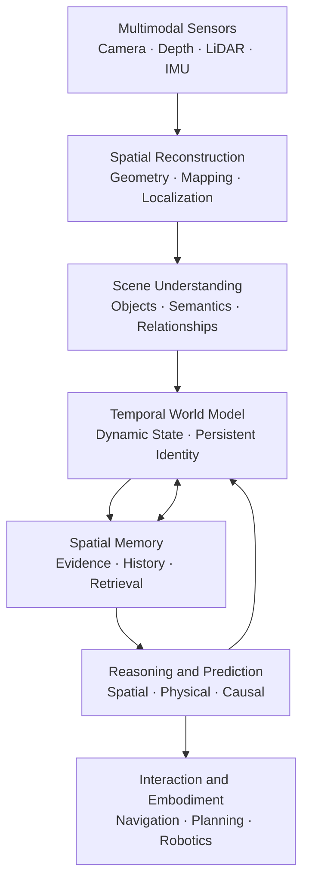

# ATLAS
### Understanding the Physical World

<p align="center">
  
</p>

<p align="center">
  <strong>Toward Persistent, Evidence-Grounded Spatial Intelligence</strong>
  <br>
  A research initiative exploring dynamic 4D scene understanding, persistent world memory, physical reasoning, and embodied interaction.
</p>

<p align="center">
  
  
  
  
</p>

<p align="center">
  <a href="#overview">Overview</a> ·
  <a href="#research-objectives">Research</a> ·
  <a href="#proposed-architecture">Architecture</a> ·
  <a href="#research-publication">Publication</a> ·
  <a href="#roadmap">Roadmap</a>
</p>

---

## Overview

**ATLAS** is an independent research initiative focused on developing a unified approach to spatial intelligence: the ability of intelligent systems to perceive, reconstruct, understand, remember, and reason about the physical world.

Today's AI systems have made significant progress in language, vision, and multimodal interaction. However, persistent understanding of physical environments introduces a different set of challenges.

An intelligent system operating in the real world must understand more than individual images or isolated observations. It must maintain spatial consistency, recognize objects across time, understand relationships, remember environmental changes, reason under uncertainty, and connect its understanding to physical interaction.

ATLAS investigates how these capabilities could be integrated into a persistent, structured, evidence-grounded world model.

**The long-term vision is to move from AI that merely observes the world to AI that can build, maintain, and reason about an evolving understanding of it.**

## Research Motivation

The direction of ATLAS was motivated in part by advances in spatial reasoning, multimodal intelligence, and embodied AI research, particularly work from **Google DeepMind**.

Relevant research includes:

- [Project Astra](https://deepmind.google/models/project-astra/) — multimodal, context-aware AI assistants, environmental understanding, and memory.
- [Gemini Robotics Technical Report](https://storage.googleapis.com/deepmind-media/gemini-robotics/gemini_robotics_report.pdf) — embodied reasoning, spatial understanding, and interaction with the physical world.
- [KilometerVision](https://storage.googleapis.com/dm-perception-test/WalkingToursMapsECCV2026_CameraReady.pdf) — large-scale spatial understanding and evaluation of spatial reasoning capabilities.

These developments motivated a broader research question:

> What would it take for an intelligent system to maintain a persistent, structured, evidence-grounded understanding of the physical world rather than interpreting every observation independently?

ATLAS is an independent initiative. Google DeepMind is a source of research inspiration and is not affiliated with, funding, endorsing, or developing this project.

## The Research Problem

Spatial intelligence requires several interconnected capabilities.

| Research challenge | Description |
|---|---|
| Geometric understanding | Reconstructing the spatial structure of physical environments |
| Semantic understanding | Recognizing objects, places, and meaningful relationships |
| Temporal consistency | Understanding how environments change over time |
| Persistent identity | Maintaining object identities across observations and sessions |
| Evidence provenance | Knowing where information came from and how it was obtained |
| Uncertainty modeling | Distinguishing measured facts, estimates, inferences, and unknowns |
| Spatial memory | Retaining and retrieving structured environmental information |
| Physical reasoning | Reasoning about spatial constraints, object properties, and interactions |
| Embodied interaction | Connecting environmental understanding to navigation and action |

These challenges are interconnected. Errors in perception can propagate into reconstruction, memory, reasoning, and downstream decisions.

ATLAS explores a unified approach to these challenges.

## Research Objectives

### 1. Persistent 4D Scene Understanding

Investigate representations combining three-dimensional environmental structure with temporal information. The objective is to understand not only what exists in an environment, but also how it changes.

### 2. Evidence-Grounded Spatial Memory

Explore mechanisms for retaining observations, spatial relationships, object identities, timestamps, uncertainty, and supporting evidence.

### 3. Persistent Object Identity

Investigate how objects can maintain consistent identities across different viewpoints, repeated observations, temporary occlusions, and separate capture sessions.

### 4. Dynamic Environment Understanding

Explore methods for distinguishing actual environmental changes from temporary occlusion, tracking errors, incomplete observations, and sensor uncertainty.

### 5. Hybrid Spatial Representation

Investigate the integration of geometric representations, semantic scene graphs, object-centric representations, and temporal memory.

### 6. Physical and Relational Reasoning

Explore spatial, semantic, functional, temporal, and physical relationships to support higher-level reasoning.

### 7. Embodied Intelligence

Investigate how persistent environmental understanding could support navigation, planning, robotics, and interaction with physical environments.

## Proposed Architecture

ATLAS proposes a modular, hybrid architecture composed of interconnected research and engineering layers.



### Architecture Layers

| Layer | Research and engineering focus |
|---|---|
| Sensor and Observation | Camera, depth, LiDAR-capable devices, IMU, and other sensor inputs |
| Spatial Reconstruction | Geometric reconstruction, tracking, mapping, and localization |
| Scene Understanding | Object detection, semantic understanding, and spatial relationships |
| Temporal World Model | Dynamic state, persistent identity, and environmental changes |
| Spatial Memory | Long-term storage, retrieval, and evidence provenance |
| Reasoning and Prediction | Spatial, physical, temporal, and causal reasoning |
| Interaction | Navigation, planning, robotics, and intelligent interfaces |

### Architectural Principles

- Evidence before assumptions.
- Explicit representation of uncertainty.
- Persistent spatial and temporal consistency.
- Separation of measured geometry from semantic inference.
- Reversible updates when new evidence contradicts previous beliefs.
- Modular and replaceable perception and reasoning models.
- Local-first processing where practical.
- Privacy-aware environmental memory.
- Evaluation through reproducible experiments.

**Note:** This architecture describes the proposed direction of ATLAS. It does not imply that every component has already been implemented or experimentally validated.

## Primary Research Questions

**RQ1 — Persistent Spatial Identity**

How can an intelligent system maintain consistent object identities across repeated observations, changing viewpoints, and temporary occlusions?

**RQ2 — Temporal Consistency**

How can a spatial representation distinguish actual environmental changes from incomplete observations and sensor uncertainty?

**RQ3 — Evidence-Grounded Memory**

How can spatial memory retain the provenance, confidence, and temporal context of information over extended periods?

**RQ4 — Hybrid World Representation**

How can geometric, semantic, relational, and temporal representations be integrated without losing spatial accuracy or interpretability?

**RQ5 — Long-Term Environmental Understanding**

How can an intelligent system incrementally update its understanding of large and changing environments?

**RQ6 — Reasoning Under Uncertainty**

How can reasoning systems distinguish measured facts, model estimates, inferred relationships, and hypothetical outcomes?

**RQ7 — Evaluation of Persistent Spatial Intelligence**

How should persistent environmental understanding be evaluated beyond single-frame recognition or isolated scene reconstruction metrics?

## Research Methodology

The proposed methodology combines established spatial AI approaches with further architectural investigations.

Potential research and evaluation areas include:

- 3D scene reconstruction.
- Visual and visual-inertial localization.
- Semantic mapping.
- 3D scene graphs.
- Object-centric representations.
- Temporal scene understanding.
- Persistent object tracking.
- Spatial memory retrieval.
- Evidence and uncertainty modeling.
- Task-oriented spatial reasoning.

### Evaluation Direction

| Evaluation area | Potential measurements |
|---|---|
| Geometric reconstruction | Reconstruction accuracy and completeness |
| Localization | Pose accuracy and tracking consistency |
| Persistent identity | Cross-session identity consistency |
| Temporal understanding | Change detection and temporal consistency |
| Scene graphs | Node, edge, and relationship quality |
| Evidence provenance | Traceability of claims to observations |
| Uncertainty | Calibration and reliability |
| Spatial memory | Retrieval accuracy and temporal relevance |
| Downstream reasoning | Task success and grounded decision quality |

### Potential Datasets

- [ScanNet](http://www.scan-net.org/)
- [ScanNet++](https://kaldir.vc.in.tum.de/scannetpp/)
- [Replica Dataset](https://github.com/facebookresearch/Replica-Dataset)
- [TUM RGB-D](https://cvg.cit.tum.de/data/datasets/rgbd-dataset)
- [KITTI](https://www.cvlibs.net/datasets/kitti/)
- [EuRoC MAV](https://projects.asl.ethz.ch/datasets/euroc-mav/)

Dataset selection will depend on the research question, data quality, evaluation suitability, and applicable usage licences.

**No experimental performance results are claimed in this initial research release.**

## Potential Applications

ATLAS is a long-term research direction with potential applications across multiple domains.

| Domain | Potential application |
|---|---|
| Spatial AI Assistants | Context-aware assistants with persistent environmental understanding |
| Robotics | Spatial memory, navigation, manipulation, and planning |
| Smart Environments | Persistent representations of homes, workplaces, and buildings |
| AR / MR | Context-aware augmented and mixed reality experiences |
| Agriculture | Spatial understanding of agricultural environments and infrastructure |
| Industrial Intelligence | Asset understanding, inspection, mapping, and change monitoring |
| Accessibility | Environmental understanding for assistive technologies |

These are potential application areas, not currently validated capabilities.

## Research Inspiration and Related Work

ATLAS builds on a broader research landscape in spatial AI, computer vision, robotics, multimodal intelligence, and 3D scene understanding.

### Google DeepMind

- [Project Astra](https://deepmind.google/models/project-astra/)
- [Gemini Robotics Technical Report](https://storage.googleapis.com/deepmind-media/gemini-robotics/gemini_robotics_report.pdf)
- [KilometerVision](https://storage.googleapis.com/dm-perception-test/WalkingToursMapsECCV2026_CameraReady.pdf)

### Spatial Intelligence and 3D Scene Graphs

- [3D Scene Graphs: Open Challenges and Future Directions](https://arxiv.org/abs/2606.19383)
- [3D Scene Graph Research Website](https://3dscenegraphs.com/)
- [3D Semantic Parsing of Large-Scale Indoor Spaces](https://doi.org/10.1109/CVPR.2016.170)

The full bibliography and additional research references are provided in the research report and associated publication materials.

## Research Publication

### ATLAS: Toward Persistent, Evidence-Grounded Spatial Intelligence

*A Hybrid Architecture for Dynamic 4D Scene Understanding, World Memory, Physical Reasoning, and Embodied Interaction.*

**Author:** Gorisi Deepak Reddy

**Academic Background:**
- MSc in Business Data Analytics
- Bachelor's in Computer Science Engineering

**Publication version:** 1.1  
**Release date:** 15 November 2026

📄 **[Read the Full Research Report (PDF)](paper/ATLAS_Public_Research_Report_v1.1_Authored.pdf)**

This publication presents a research vision and proposed architecture. It is not a peer-reviewed publication, an MIT publication, or a report of a completed experimental system.

## Project Status

ATLAS is currently in its initial public research phase.

| Component | Status |
|---|---|
| Research vision | Documented |
| Research motivation | Documented |
| Initial literature review | Completed |
| Proposed architecture | Documented |
| Research questions | Defined |
| Evaluation methodology | Proposed |
| Prototype implementation | Not yet validated |
| Benchmark experiments | Pending |
| Experimental results | Not yet available |

The project will distinguish clearly between proposed research, implemented components, and experimentally validated capabilities.

## Roadmap

### Phase 1 — Research Foundation

- Establish the research problem and scope.
- Review relevant spatial AI literature.
- Formalize the proposed world representation.
- Define evaluation requirements.

### Phase 2 — Spatial Reconstruction

- Investigate sensor ingestion.
- Develop reconstruction and localization pipelines.
- Establish coordinate and calibration conventions.
- Evaluate geometric consistency.

### Phase 3 — Persistent World Memory

- Investigate persistent object identity.
- Develop temporal scene representations.
- Explore evidence-grounded memory.
- Evaluate change detection and cross-session consistency.

### Phase 4 — Spatial Reasoning

- Integrate semantic and relational representations.
- Investigate physical and functional reasoning.
- Explore predictive world models.
- Evaluate reasoning against grounded evidence.

### Phase 5 — Embodied Applications

- Explore navigation and planning.
- Investigate robotics and interactive applications.
- Evaluate performance in controlled and real-world environments.

This roadmap is exploratory and subject to revision as research and experimental findings develop.

## Repository Structure

```text
atlas-spatial-intelligence/
│
├── README.md
├── LICENSE
├── CITATION.cff
├── CONTRIBUTING.md
├── CODE_OF_CONDUCT.md
├── .gitignore
│
├── paper/
│   ├── ATLAS_Public_Research_Report_v1.1_Authored.pdf
│   ├── manuscript.md
│   ├── references.bib
│   └── figures/
│
├── research/
│   ├── research-motivation.md
│   ├── problem-definition.md
│   ├── research-questions.md
│   ├── related-work.md
│   ├── proposed-architecture.md
│   ├── evaluation-methodology.md
│   ├── limitations.md
│   └── research-roadmap.md
│
├── architecture/
│   ├── README.md
│   ├── system-overview.md
│   ├── spatial-representation.md
│   ├── temporal-world-memory.md
│   ├── evidence-and-uncertainty.md
│   └── diagrams/
│
├── datasets/
│   ├── README.md
│   ├── public-datasets.md
│   └── evaluation-protocols.md
│
├── experiments/
│   ├── README.md
│   ├── baselines/
│   ├── metrics/
│   └── results/
│
├── docs/
│   ├── vision.md
│   ├── terminology.md
│   ├── frequently-asked-questions.md
│   └── project-status.md
│
├── assets/
│   ├── atlas-banner.png
│   ├── logo/
│   ├── diagrams/
│   └── images/
│
└── implementation/
    └── README.md
```

Not every directory needs to contain files in the initial release. Future research and implementation materials will be added as they become available.

## Licensing

### Research Documentation

Unless otherwise stated, original research documentation and written materials in this repository are licensed under:

**[Creative Commons Attribution 4.0 International (CC BY 4.0)](https://creativecommons.org/licenses/by/4.0/)**

You may share and adapt licensed materials, including for commercial purposes, provided you comply with the licence terms and give appropriate attribution.

Third-party materials, trademarks, and separately licensed resources are excluded.

Future software implementations may use a separate software licence, such as Apache License 2.0. Any such licence will be explicitly identified.

## Contributing

ATLAS is intended to develop through research, engineering, experimentation, and technical discussion.

Contributions and discussions related to the following areas are welcome:

- Spatial AI and 3D scene understanding.
- Persistent 4D representations.
- Semantic and metric mapping.
- Temporal world models.
- Spatial memory architectures.
- Robotics and embodied intelligence.
- Evidence-grounded reasoning.
- Evaluation methodologies and reproducibility.

Please review the contribution guidelines before submitting proposals or changes.

## Author

**Gorisi Deepak Reddy**

- MSc in Business Data Analytics
- Bachelor's in Computer Science Engineering

Creator and Research Author of ATLAS.

## Acknowledgements

ATLAS acknowledges the broader research community working in spatial intelligence, robotics, computer vision, multimodal AI, and embodied systems.

The research direction was informed in part by publicly available research from Google DeepMind and other academic and industrial research groups.

All external research contributions remain attributed to their respective authors and institutions.

## Disclaimer

ATLAS is an independent research initiative.

This project is not affiliated with or endorsed by Google DeepMind, MIT, or any other institution mentioned in its research references.

The proposed architecture and research objectives are exploratory. Their effectiveness, feasibility, novelty, and performance require implementation and independent experimental validation.

Project descriptions and future application scenarios should not be interpreted as claims of existing capabilities.

---

<p align="center">
  <strong>ATLAS</strong>
  <br>
  Understanding the Physical World.
  <br><br>
  <sub>Building toward persistent, evidence-grounded spatial intelligence.</sub>
</p>